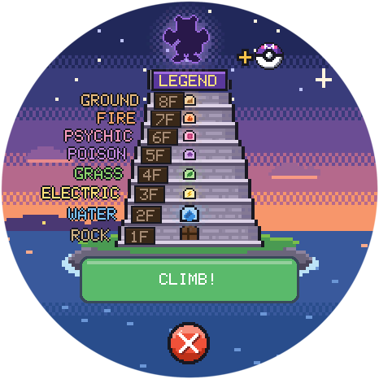
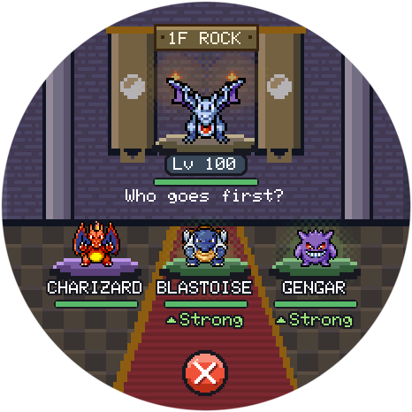
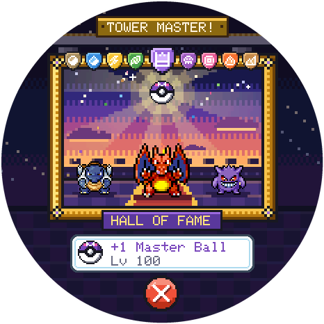

# How Catch 151 works

Everything your Pokémon needs, what each action does, and how to fill the Pokédex.

## The symbols

| Symbol | Meaning | What it does |
|---|---|---|
| 🍖 | Food | Drops fastest. Below 30, joy drains faster. |
| 😊 | Joy | Earned mostly by playing and battling. |
| ⚡ | Energy | Needed for battles. Restored by sleep. |
| 🧼 | Hygiene | Restored by a bath. Each poop makes it drop faster. |
| 💞 | Bond | Grows with care, up to 20 points a day. |
| ⚖️ | Weight | Every meal adds a little (berry +4, candy +12), and eating while already full adds 6 more. It burns off slowly (1 every 6 minutes, slower asleep), and games and battles burn more. Above 50, energy drains twice as fast; above 60 it looks chubby. |
| 💪 | Strength | Trained by battling. |
| 💨 | Speed | Trained by playing active games. |
| 🛡️ | Defense | Trained by staying well cared for. |

## Taking care of it

| Action | 🍖 | 😊 | ⚡ | 🧼 | 💞 | ⚖️ | Limit |
|---|---|---|---|---|---|---|---|
| 🤚 **Pet** | | +5 | | | +1 | | Only the first 3 pets each hour add joy |
| 🍓 **Favorite berry** | +35 | +10 | | −25 if already full | +2 | | |
| 🫐 **Other berries** | +25 | | | −25 if already full | | | |
| 🍬 **Candy** | +10 | +12 | Full | | | +12 | 2 a day (3 on the day the visitor brings one): a red number on it shows how many are left, and it leaves the menu at 0 |
| 🛁 **Bath** | | | | Full | +1 | | Also clears every poop |
| 🌙 **Sleep** | | | +6 a minute | | | | Turn the light off, then back on to wake it. While it sleeps the clock moves down under it, big, so a Knomi left on a desk is a bedside clock |

There are three berries, a Razz, an Oran and a Pinap Berry, and each Pokémon has one favorite. Try them to find out which: once found, it shows on the Pokémon's card. Berries and candy are in the backpack, the first icon: tap one and it drops onto your Pokémon, and the backpack stays open for another. Don't overfeed it: a berry given when the food bar is already full makes a mess, and takes a quarter off its hygiene. Your Repels are in there too (see [Items](#items)).

## Games

Games don't raise anything if you quit by swiping up.

| Game | 😊 | ⚡ | 🍖 | 💨 | Bond 💞 | Burns ⚖️ |
|---|---|---|---|---|---|---|
| 🍓 **Berry Drop** | +5, plus 2 per point | −10, more for high scores | **+5** | Yes | +2 | Yes |
| 🏃 **Rock Hopper** | +5, plus 2 per 4 seconds | −10, more for long runs | −5 | Yes | +2 | Yes |
| 🏄 **PikaSurf** | +5, plus 2 per 4 seconds | −10, more for long runs | −5 | Yes | +2 | Yes |
| 🕳️ **Dungeon Crawler** | +5, plus 4 per floor | −10, more for deep dives | −5 | Yes | +2 | Yes |
| 🎣 **Reel Fishing** | +5, plus 2 per 44 lb | −10, more for heavy catches | −5 | Yes | +2 | Yes |
| 🕹️ **Pinball** | +5, plus 2 per 400 points | −10, more for high scores | −5 | Yes | +2 | Yes |
| 🫐 **BerryMatch** | +5, plus 2 per 200 points | −10, more for high scores | −5 | Yes | +2 | Yes |
| ❓ **Who's That?** | +3, plus 3 per right answer | | | | +1 | |

Berry Drop, Rock Hopper, PikaSurf, Dungeon Crawler, Reel Fishing, Pinball and BerryMatch each add at most +35 joy per game. Who's That? adds at most +33, with ten seconds for each silhouette: out of time counts as wrong. Energy and food won't drop below 5 from a game.

At the end, **Play Again!** starts the same game again and the ✕ goes back to the games; a tap on the Repel bar under them opens the Repel's page on your Pokémon's card. Every second you actually play counts toward a Repel (see [Items](#items)): not the how-to card or the end, and only while you're touching, tilting or pressing keys, so sitting in the dungeon earns nothing. The games with a buddy count too.

### Reel Fishing

Five casts off the end of the Beach's pier. The fish are the Beach's water Pokémon, seen as shadows, and each one weighs 0.8 to 1.2 times its Pokédex weight: the bigger its shadow, the heavier it is. The score is the total weight of the fish you land, and every one is let go.

| Size | Weight | Where | Fish | Taps a second | Green | Good taps | Strike within |
|---|---|---|---|---:|---:|---:|---:|
| **Small** | 7–33 lb | The shallows | Shellder, Krabby, Horsea, Magikarp, Poliwag | 3.2 | 62–80% | 22 | 0.9 s |
| **Middling** | 35–121 lb | The shallows and open water | Psyduck, Slowpoke, Goldeen, Poliwhirl, Seadra, Staryu, Seaking, Tentacool | 2.5 | 65–82% | 26 | 0.75 s |
| **Big** | 97–238 lb | Open water and the deep | Tentacruel, Kingler, Golduck, Slowbro, Starmie, Seel | 2.0 | 68–84% | 30 | 0.65 s |
| **Heavy** | 212–351 lb | The deep | Dewgong, Cloyster | 1.6 | 71–86% | 31 | 0.6 s |
| **Giant** | 388–622 lb | The deep | Lapras, Gyarados | 1.25 | 74–88% | 33 | 0.6 s |

- **The water:** there are always 3 small, 2 middling and 1 big fish in sight (now and then a heavy one in the big one's place), and a fish that's gone comes back as another of its size 2.5 seconds later. One giant swims in for cast 3, 4 or 5 of every game and stays until it's hooked or the game ends. About 1 fish in 100 is shiny.
- **Casting:** tap the water (or aim with the tilt or the arrow keys and press the button or Space). The float lands out past the middle of the screen, within a little of where you tapped. The fish nearest the float comes round to the hook, sooner the closer it is; bubbles over a fish mean it's eager and bites quicker.
- **Nibbles:** before the bite the float dips a few times: none (then the bite takes longer) 20 casts in 100, one 15, two 35 and three 30. A tap on a nibble is **TOO SOON!**: that fish darts off and another comes, and the cast goes on.
- **The bite:** the float goes under, with a **!**, a splash and the screen's edge glowing, and the Knomi's backlight flashes. Tap within the strike time in the table, or **TOO SLOW!** and it's gone with that cast. A strike in the first third of that time is clean and starts the fight with the needle in the middle of the green; a late one starts it near the slack end.
- **Reeling:** each tap tightens the line by a step, and the fish pulls it back between taps, a little harder or softer on each beat. The **LINE** bar on the right shows it, its white needle rising and sinking: a tap with the needle in the green counts toward landing it (the good taps in the table), and the fish comes in toward the pier as they add up. Over the green, the bar turns red (**SLOWER!**), and the needle reaching the top snaps the line. Under it, the line goes slack (**FASTER!**), and 1.5 seconds slack and it slips off. Now and then the fish thrashes and pulls the line tighter for a moment: the blob flashes just before, so tap slower through it. The hooked fish swells on every beat, and on a computer and the web the fight song plays at its pace, one tap a beat.
- **The weigh-in:** a fish landed leaps out with its name, then a gold gauge on the left fills to its weight and says how big it is for one of its kind (**A SMALL ONE**, **A GOOD ONE** or **A BIG ONE**), and back in it goes. A giant landed is **THE BIG ONE!**
- **The score:** the five casts' weights add up against three lines, **bronze at 110 lb, silver at 331 and gold at 661** (50, 150 and 300 kg), and your best total is kept. Weights show in pounds, to a tenth. Joy and speed training come from the total, a point for every 44 lb (20 kg): 2 joy a point (up to +35 in all) and 1 speed training for every 5 points, so every 220 lb.
- **Your biggest fish:** the heaviest single fish you've landed is kept too, and the weigh-in of one that beats it says **YOUR BIGGEST EVER!** The heaviest anyone has landed shows on the minigame leaderboard (the game tells the buddy relay only the weight, the kind and your gamer tag).

### The leaderboard and your gamer tag

Each minigame's best ten, from every copy of the game, are on the **[Leaderboard](https://fedorsosnin.github.io/Catch151/leaderboard/)**, with the gamer tag that set each one and the day: Berry Drop's score, Rock Hopper's longest run, Dungeon Crawler's deepest floor, PikaSurf's longest ride, Reel Fishing's biggest fish, Pinball's score and BerryMatch's score. The README shows each game's best.

- **A record for each fish:** the leaderboard page also lists every kind of fish Reel Fishing has, 23 of them, each with the heaviest anyone has landed, who landed it and the day. The ones nobody has caught yet wait there too. Your game sends the heaviest of each kind you've landed, from 2.2.11 on (your biggest fish before then counts for its kind).

- **Your gamer tag:** up to four characters, typed on the keyboard. The game asks for it once, after your first game with a score; after that, the label on the Game Boy under **GAMES** in the Games menu changes it (four bars until you have one). A rude one gets **PICK ANOTHER**, and one that gets through anyway shows as `****` on the leaderboard.
- **What's sent:** your best in each game since the board started over (2.2.10: each game keeps a best for the board from zero, beside its all-time record), your tag, and nothing else about you, when the game reaches the buddy relay, at each game's end, and when your tag changes. Only your best counts, once a game: a better one replaces it.

### The keyboard

Ten keys a row are small on the Knomi, so the keyboard zooms: tap near the letter you want and the keys around it grow about three times wider; tap the big ones to type, as many as you like. The blue down arrow where the X was goes back to the whole keyboard. Shift, ⌫, 123, SPACE and OK work at once on the whole one. Hold a key to see it big over your finger; slide off before you let go to change your mind. The same keyboard types your Pokémon's name, your gamer tag and the Knomi's Wi-Fi password. The zoom is for fingers: on the Mac and Windows apps, and with a mouse in the browser, the keyboard stays whole and a click types the letter under it; the web game on a phone or a tablet zooms like the Knomi.

### Pinball

A round table, the round screen itself, its rim the wall, with a drain between the two flippers. Hold the left or right half of the screen to raise that flipper; the Knomi's button (Space on a computer) raises both, and on a computer the left and right arrows raise each. Three balls; the best score is kept. Each game deals one of two tables at random: night-blue on a chrome rim, with a cave by the right wall, or a meadow on a wooden one, with a patch of tall grass there. The corners where the wall meets the rails down to the flippers are rounded, so a ball rolling round the rim keeps its speed onto a flipper.

| What | Points |
|---|---:|
| A slingshot | 5 |
| A bumper (the Poké Ball, the Great Ball, the Ultra Ball) | 10 |
| Round the orbit | 50 |
| A hit on the wild one in the ring | 50 |
| Up the ramp and over | 250 |
| A wild one knocked out | 500 |
| Diglett, or each of Dugtrio's three heads | 1000 |
| All three of Dugtrio's heads, on top | 2000 |

- **The ramp:** from its mouth left of the middle (the arrows on the floor show the shot, from the right flipper) straight up into the top-left corner, round over into the wall and down a wire rail to your left flipper. A shot too slow rolls back down and out.
- **The orbit and the berries:** a lane round the top, under the wire rail on the left, with six berry lights in it. The ball rolling over one lights it; all six lit and every point after counts **x2** for the rest of the game (the next six, **x3**), and they start over. Going round over the top scores 50.
- **Diglett:** light all three bumpers and Diglett pops out of its hole between them for 12 seconds, a gold ring round it counting down. Hit it in time for 1000; then the bumpers start over.
- **Dugtrio:** beat Diglett twice and the next one up evolves into Dugtrio (it can't be hit while it evolves). It stays up 20 seconds, three gold dots under it for its three heads: each hit knocks one down (1000), and the third knocks it out (2000 more). Then it's Diglett again and the count starts over. If Dugtrio gets away, it comes back as Dugtrio.
- **The battle in the ring:** the ball into the gap in the tall grass by the right wall (on the night table, into the cave's mouth) brings out a wild Pokémon of about your Pokémon's level that lives there, picked as a Search in its zone picks one: out of the grass one of the Forest's or the Field's, out of the cave one of the Cave's (never Diglett or Dugtrio, the bumpers' own; a zone's legendary, seldom). It jumps into the ring in the middle with its HP over it and 20 seconds on a gold ring round it. Each hit of the ball is the stronger of your Pokémon's two moves, its damage worked out as in a battle (its type against the wild one's), but always between two and five hits to knock it out. While one is in the ring the grass (or the cave) takes no ball, and losing the ball ends the battle. Nothing outside Pinball changes: it isn't caught or added to the Pokédex.
- **Rewards:** joy and speed training from the score, a point for every 400, as the table above. A ball stuck still for 2.5 seconds (anywhere but held up on a flipper) gets a nudge.
- **The pace:** the Knomi draws about 10 frames a second, so the table is a gentle one, low gravity and a top speed the eye can follow, and the ball moves in many small steps between frames so it never passes through a flipper.

### BerryMatch

A board of berries to swap and line up, 5 squares by 5 with the four corners cut off so it sits round on the round screen, 21 squares in all. Each square is 76 px, the pieces the game's own food icons at the backpack's size (72 px, four times the icon, so they're sharp on the Knomi): the Razz, Oran and Pinap Berries and the Rare Candy. Poké Balls only come as the special balls. A game starts with twenty moves and playing well earns more; the best score is kept.

- **Swapping:** tap a piece and it lights up with a gold outline and hops; tap one next to it (above, below or beside, not corner to corner) and the two swap. Tap it again to put it down, or tap another one farther off to pick that one instead. With a piece picked, a tap that just misses the one beside it (onto a corner-to-corner square, or a little past it) still swaps with it, as long as it points clearly along the row or the column. A swap that lines nothing up slides back and costs nothing. Pieces act the moment they're touched.
- **Catching:** three or more of a kind in a row or a column are caught and spin away. The pieces above fall into the gaps, new ones drop in from the top of each column, and anything that lines up as they land is caught too: a chain. A piece can be picked while the board is still moving; a swap asked for then waits until it settles.
- **Points:** 10 a piece, times the step of the chain: the swap's own catch is step 1, what lines up after the first fall step 2 (20 a piece), and so on.
- **The balls:** four in a line leave a **Great Ball** where the piece you moved landed (or in the line's middle, in a chain); a row and a column of one kind crossing, an L or a T, leave an **Ultra Ball** where they cross; five in a line leave a **Master Ball**. Balls aren't a kind and don't line up: swap one with any piece next to it (always a move) and it goes off where it lands. A Great Ball catches its whole row and column, an Ultra Ball everything up to two steps away, a Master Ball the whole board. A ball caught by another one goes off too.
- **No moves left:** when no swap would line anything up (and no ball is on the board), **SHUFFLE!**: the same pieces turn round into new places, with a swap that works and nothing already lined up. It costs no move.
- **Your Pokémon plays along:** it walks in from the edge of the round screen to one of the board's four cut corners, watches for a few seconds, and walks back out; a few seconds later it comes in at another corner. It hops when you make a ball, set one off, earn moves or keep a chain going, and if it's away it comes straight back to see.
- **A hint:** ten seconds with nothing done and two pieces that would match start to wiggle, until you tap. Three hints a game, then no more.
- **Earning moves:** a Great Ball made earns 1 move, an Ultra Ball 2 and a Master Ball 3, and a chain that keeps going after its third catch earns 1 for each catch after that (the fourth, the fifth...). A green **+1** (or +2, +3) rises by the count of moves left, which flashes green. The count stops at 99. A game lasts about 35 moves on average, a lucky one 80 or more.
- **The last moves:** the count under the board turns gold for the last three, and **LAST MOVE!** shows when the board is ready for the last one (a move that earns more isn't the last). When the moves are gone and the board settles, the game ends: the score, the record and Play Again!
- **On a computer and the web:** the mouse works as a finger. The arrow keys move a white cursor round the board (past the cut corners), Space picks the piece under it, and with one picked an arrow swaps it that way. Space also sends off the how-to card, as the Knomi's button does.
- **Rewards:** joy and speed training from the score, a point for every 200 (a game scores about 4,000 on average), as the table above. The game plays Berry Drop's song.

## Battles

Your Pokémon needs at least 15 ⚡ to fight.

| Result | 😊 | ⚡ | 🍖 | 💪 | 💞 | ⚖️ |
|---|---|---|---|---|---|---|
| 🏆 **Win** | +10 | −12 | −5 | +3 | +2 | −5 |
| 💫 **Loss** | −5 | Drops to 5 | −5 | | | −5 |
| 🤝 **Win against a buddy** | +15 | | | | +2 | |
| 🤝 **Loss against a buddy** | +8 | | | | +2 | |

**RUN** leaves a wild battle, but 1 time in 20 it fails: the button says **Couldn't get away!** for the rest of that fight, so it's fight or lose. A battle with a buddy can always be left.

### Moves

Two moves, one per button: on the right the strongest of its own type, on the left the strongest of any other type. They come from its species' Red and Blue level-up attacks (moves that do no damage are left out), up to its level, which goes up 1 every hour of age. Training and wins don't teach moves. A new move shows as **Learned …!** at the start of the next wild battle, and only if it's stronger than the one on its button. Evolving switches to the new form's list.

| Charmander's level | Left | Right |
|---|---|---|
| 1 | Scratch (one wide button) | |
| 9 | Scratch | Ember |
| 30 | Slash | Ember |
| 38 | Slash | Flamethrower |

Ditto copies the wild Pokémon's moves. **[Every Pokémon's moves and levels](MOVES.md)** has the whole list for all 151, with each move's power.

### Results

A loss earns nothing: no training and no bond. After a loss, your Pokémon has to sleep before it can fight again. Every wild or Travel battle you fight to the end, won or lost, counts toward your next Ultra and Master Ball (see [Items](#items)). Beat any wild Pokémon, even one you have, and you get 3 Poké Balls to catch it while it runs back and forth trying to get away, with any Ultra and Master Balls you hold beside them: tap a ball to choose it, then the **Throw** button (in its colour, with its name) throws it. Each catch starts on the Poké Ball, and with only Poké Balls the button is ready (a tap on the ball throws too). You can't swipe out of a battle or a catch. It runs at its own speed (its base speed: a Slowpoke takes about 6 s there and back, an Electrode under 3), speeds up and slows down on the way, and the quick ones sometimes turn back early. Where the ball lands, against the rings that run with it, decides how likely it is to hold: in the small green circle 100%, in the bold second ring 75%, in the faint outer ring 25%. A ball that hits drops to the ground before the count. If it doesn't hold, the Pokémon breaks out on one of the three shakes and runs away. Any ball that hits ends the catch, held or not; an Ultra or Master Ball that misses isn't used up.

### Stars

Every form in the Pokédex (regular and shiny count apart) has 1–3 ★: its genes, kept simple. Genes are each stat's 90–110%.

| ★ | A catch rolls it | A raised Pokémon's genes (their average) |
|---|---|---|
| ★ | 50% | 90–96 |
| ★★ | 35% | 97–103 |
| ★★★ | 15% | 104–110 |

- **Catching:** once the ball holds, a screen of its own shows the Pokémon and its stars, and stays until you tap its ✕. A new form joins with them ("New in your Pokédex!"). If you have that form and the catch has more stars, it replaces your weaker one at once ("New best!"); otherwise yours stays and the catch goes back to the wild.
- **Raising:** choosing or evolving registers the form with your Pokémon's own stars, and never lowers a form you have.
- **Choosing your next Pokémon:** its genes are rolled inside the band of the form you pick, so a 3★ form gives a 3★ Pokémon. A starter you've caught comes with that form's stars; one you haven't rolls 90–110.
- **Trading:** the stars go with the Pokémon. If you already have the form you get, you keep the higher. From a buddy on an older version, the stars are rolled.
- **Where:** each Pokémon's Pokédex page, under its sprite (each form its own row), the trade screen and the next-Pokémon choice. In the Pokédex and zone grids, a Pokémon with a 3★ form (regular or shiny) has three small gold stars under it.

## Training

- **Winning a battle** adds attack training (+3 a win).
- **Every 6 hours of good care** adds defense training (+1). Good care means every need stays at 40 or more. Hours asleep count too, and a need can dip under 40 for up to 15 minutes while it's awake (time to notice and feed it) before the 6 hours start over. The count is saved, so a restart or an update doesn't lose it.
- **Mini games** add speed training: Berry Drop, Rock Hopper, PikaSurf, Dungeon Crawler, Reel Fishing, Pinball and BerryMatch add 1 for every 5 points.
- **Weight** isn't training: every berry adds 4 and candy 12 (6 more if it was already 80% full). Games, battles and time burn it off. Over 50, energy drops twice as fast; 20 or less earns the Fit medal.

Each kind of training stops at 100. Hold your Pokémon and tap **Stats** for the card, then two pages on: the **Training** page shows each one's bar, with **MAX** when it's full, and what trains it, plus a row for weight. Training belongs to the Pokémon: a new one starts from zero.

## Party Boost

While at least one buddy or the daily visitor is on your screen:

| Boost | |
|---|---|
| ⚡ **Energy drain** | A quarter less: it drops three minutes in four instead of every minute (overweight too) |
| 💪 **ATK, DEF, SPD** | +2 each in wild battles and Dungeon Crawler (not in battles between buddies) |

It's the same with one friend or five, so extra devices don't stack it. Tap the round Party Boost button (two balloons and **+2**, to the right of your Pokémon) for the list of who's here. Tap a friend for its stats (level, HP, ATK, DEF, SPD, and a buddy's Pokédex count), then swipe to a buddy's Battle, Trade and Play menu. The ✕ goes back to the list.

The **daily visitor** brings a candy (a third one that day) and stays 60 minutes. It only arrives while yours is awake, but once it's there it stays even if yours goes to sleep, its minutes still running. It steps out while four buddies fill the row and comes back the same day, and its time survives a restart. Leftover minutes end at midnight. Tap it to see its stats.

## Items

Kept with you from one Pokémon to the next, up to 99 of each. Each has its own page on the card (**Stats** in the hold menu, then the next pages), with how far along the next one is.

| Item | Earned | What it does |
|---|---|---|
| 🟡 **Ultra Ball** | Every 25 wild or Travel battles fought to the end, won or lost | Triples the catch chance when it hits (it can still break out) |
| 🟣 **Master Ball** | Every 100 of those battles | Always catches the Pokémon it hits |
| 🧴 **Repel** | Every 10 minutes of mini games actually played | Spray it from the backpack: for 3 of the game's minutes, weaker wild Pokémon stay away |

At the end of each of those battles, both balls' bars come up in the middle of the screen and this battle's step fills in on each. Running away, battles with buddies and Dungeon Crawler don't count toward the balls. On the catch screen, the balls you hold sit in a row, each the button for its throw: with both a Master and an Ultra Ball, the Master Ball, the Poké Ball in the middle, then the Ultra Ball.

While a Repel works, wild encounters, and zones you've caught everything in, bring no Pokémon below your Pokémon's level and no species whose base stats add up to less than yours (if that leaves nobody, the usual pick). In a zone you haven't finished, every Pokémon there except its legendary is equally likely, and the legendary keeps its 1 in 100. Shiny odds don't change. It runs out while the Knomi is off, too. The backpack shows a badge with its minutes left, and a Repel used while one runs does nothing.

## Zones

There are two ways to start a battle:

- 🔘 **The physical button, or Wild Encounter (the last circle, after the zones):** a random wild Pokémon from anywhere, met at your Pokémon's home. From the island, you're back there when the battle ends, as a zone's Search brings you back to the zone; from the button, back home. The Mac, Windows and web versions have no button, so Wild Encounter is the way there (or Space on a keyboard).
- 🗺️ **Travel, the map icon on the home screen:** tap a zone on Knomi Island and hunt there. Missing Pokémon show as silhouettes. Most Searches look first among the ones you're missing there, the rare ones too but less often, as a Wild Encounter does; never the legendary, which turns up about once in a hundred. The arrow on the right slides Travel out along the pier to the tower's islet: [Knomi Tower](#knomi-tower).

| Zone | Pokémon | Who lives there | Rare 💎 | Legendary ⭐ |
|---|---|---|---|---|
| 🌲 **Forest** | 41 | Grass, bugs and forest animals | Tangela, Scyther, Pinsir | Mew |
| 🏖️ **Beach** | 30 | Water and Ice | Jynx, Lapras | Articuno |
| 🪨 **Cave** | 31 | Rock, Ground, Fighting and Dragon, plus Zubat and Clefairy | Onix, Hitmonlee, Hitmonchan, Rhyhorn, Magmar, Omanyte, Kabuto, Aerodactyl, Dratini | Moltres |
| 👻 **Mansion** | 21 | Ghost, Psychic, poison gas and sludge, and machines | Grimer, Mr. Mime, Electabuzz, Ditto, Porygon | Mewtwo |
| 🌾 **Field** | 28 | Birds, Normal, Eevee and fire runners | Growlithe, Ponyta, Farfetch'd, Lickitung, Chansey, Kangaskhan, Tauros, Snorlax | Zapdos |

Every zone's Pokémon are **common**, **rare** or **legendary**:

- **Common** ones turn up all the time. Their evolved forms come half as often.
- 💎 **Rare** ones, and what they evolve into (Dratini to Dragonite, Growlithe to Arcanine...), come about a third as often as a common one.
- ⭐ The **legendary** can turn up on any Search, from the very first, but only about 1 Search in 100. Evolved forms only appear once your Pokémon is high enough level. All 151 can be caught this way, and catching all of a zone earns its zone medal.

✨ About 1 wild Pokémon in 100 is shiny. Its shiny form goes into the Pokédex separately from the regular one, so you can have both, and each can be traded on its own.

## Knomi Tower

A climb of ten fights in a row: eight floors, each with one guardian, then the Legend's two at the top. Your Pokémon and two friends go up together, and their HP carries from fight to fight, so who you send in matters as much as how strong they are.

  

### Getting there

Open **Travel** (the map) and tap the arrow on the right: the island slides away along the pier to the tower's islet, with Mewtwo's shadow hovering over the roof. Tap the tower. Its tag shows your best climb so far (**Best: 6F**, or **LEGEND** once it's beaten).

The tower screen shows all eight floors, each window lit in its floor's colour with the type's name beside it (the **floor guide**), and the Master Ball waiting at the top. Tap **CLIMB!**. The first time, a card explains how it works.

### Your team

Your own Pokémon always goes, plus **two friends** from your Pokédex: any form you've caught except the one you're raising, shinies included. Pick them from the Pokédex's own grid. A form your level doesn't allow yet shows as a shadow with the level it needs.

Friends fight at **your Pokémon's level and training** (ATK, DEF, SPD), with the genes of the stars you caught them with: a 3★ friend is a little stronger than a 2★. Your own Pokémon fights with its own genes. The team you picked is offered again next time; tap a friend on the team screen to change it, then **GO!**

### Energy

A climb needs a **full energy bar** (90 or more). Each fight won uses 9, so a whole climb uses the whole bar. Losing a climb leaves your Pokémon exhausted, like a lost battle: it needs a rest (or a candy) before the next one.

### The floors

| Floor | Guardian's type |
|---|---|
| 1F | Rock |
| 2F | Water |
| 3F | Electric |
| 4F | Grass |
| 5F | Poison |
| 6F | Psychic |
| 7F | Fire |
| 8F | Ground |
| **The Legend** | The strongest of Ice, Fighting, Ghost or Dragon, then **Mewtwo** |

Each guardian is one of the three strongest Pokémon of its type that your level allows (never a legendary), at your Pokémon's level or up to 3 above. Guardians are bosses, with more HP than their level gives, more the higher you go, and better trained than the floor below.

### Who goes first

Before each fight, **Who goes first?** shows your team, each on its dais with its HP:

- **▲ Strong:** it should win this fight with a turn to spare.
- **▼ Weak:** it should lose it.
- Nothing: too close to call.

It's worked out from the fight itself, not just the two types: both Pokémon's moves (the guardian's as often as it uses each), their stats, the HP each has right now, and who's faster. Rhydon is Ground and Kabutops is Rock, but Kabutops' Water move and speed win, so Rhydon isn't **Strong** there.

The fight is a normal battle with your two moves. **RUN** always works in the tower, and ends the climb (it doesn't count as a loss).

### HP carries over

- Your team's HP **carries from fight to fight**. Between floors, everyone still standing gets **20%** of their HP back. Before Mewtwo they get it too.
- A Pokémon that faints sleeps on its dais for the rest of the climb, **Fainted** under its name.
- The guardian keeps its HP from one of yours to the next, and when it beats one, it **drains 30%** of its own HP back: its bar climbs while you watch. Then you pick who's next.
- When all three have fainted, the climb is over.

### The end of a climb

**Climb over** shows who beat you and where, with a tip about what to try next:

- If the one beaten last was Weak against it: *"CHARIZARD was Weak against KINGLER. Try a GRASS/ELECTRIC friend!"*, naming types that hit it hard and that its moves don't hit hard.
- If nobody on the team was Strong against it, the same, with those types.
- Otherwise, the guardian's training against yours, and the training your team is shortest of (DEF from good care, ATK from battles, SPD from mini games).

### Friends cheer

Lost climbs aren't wasted: each climb lost in a row gives the next one **+5% HP** for the whole team, up to **+15%**. A gold disc beside the tower shows what's waiting, and so do the team screen and the "needs a full energy bar" card. Reaching a new best floor starts it over, and once the Legend is beaten there's no more cheering.

### Rewards

- **Every tower fight** you fight to the end fills the **Ultra Ball's and Master Ball's bars**, like any battle: an Ultra Ball every 25, a Master Ball every 100.
- **Beating the Legend** (both fights) earns a **Master Ball, every time**.
- The first time, it earns the **Tower Master** badge in the trophy case.
- Each floor won shows its **badge** (Rock Badge, Water Badge…) on a row of the climb's eight. They're the climb's own and start over each climb.
- Your Pokémon's own wins in the tower train its ATK and make it happy, like any battle won.

### Hall of Fame

The first team to beat the tower is kept as the **Hall of Fame**: the Tower Master screen shows them in a gold frame with the level they climbed at, after that climb and every one after. Travel's tag keeps your best floor.

### Challenges

Once the Legend is beaten, three medals sit beside it on the tower screen (tap them to see what they are). Each turns gold when you beat the whole tower again:

- **No one fainting.**
- **Two 1-star friends.**
- **No evolved Pokémon:** your Pokémon and both friends in their first forms.

A climb that earns one shows it with **NEW!** after the Tower Master screen.

### How hard is it?

The top is meant to be a real challenge. A Lv 100 team of 3★ Pokémon with full ATK and SPD training, DEF at about 25 (a daily player's), types that fit the floors and the Strong picks first clears the whole tower about **1 time in 4**. A team at Lv 45 with 2★ friends usually stops around 3F–4F and doesn't reach 8F, and a team at Lv 15 rarely gets past 2F.

## What drops over time

| | 🍖 | 😊 | ⚡ | 🧼 | ⚖️ |
|---|---|---|---|---|---|
| ☀️ **Awake, per minute** | −2 | −1 | −1 | −1, plus −4 per poop | −1 every 3 minutes |
| 🌙 **Asleep** | −1 every 2 minutes, stops at 30 | −1 every 2 minutes, stops at 35 | +6 a minute | −1 every 3 minutes, stops at 45 | −1 every 3 minutes |

Joy also drops 2 more per minute while 🍖 is below 30, and 2 more while 🧼 is below 30.

## Time

The game counts its own minutes, and only a clock nobody can set adds time away. Changing a device's clock moves the hours on screen, never your Pokémon's age, and never hands out an extra day.

| What | How |
|---|---|
| 🕰️ **Time away** | Applied when you come back, up to 2 weeks at once. The Knomi measures it by network time over Wi-Fi. Mac, Windows and the web ask a time server when they start, and keep counting with the computer's own clock, which runs on while it sleeps and can't be set. Without Wi-Fi or a server, time away waits until one answers. |
| 📅 **A new day** | Candies, the visitor and the streak move on at midnight, once 12 hours have been played since the last day began. The day never goes back, so a clock that's wrong and then corrected loses nothing and keeps the streak going. |
| 🌍 **Time zone** | The Knomi uses the city you pick (**Settings** in the hold menu, tap the city). Mac, Windows and the web use the computer's. |
| ✋ **Setting the time** | Only on a Knomi without Wi-Fi: on Wi-Fi, and on Mac, Windows and the web, the time screen just shows the clock. |

## Growing up

| What | How |
|---|---|
| ⬆️ **Level** | +1 for every hour of age, up to 100. A Pokémon stays at 100 from then on, so it doesn't grow too strong for battles |
| 🛡️ **Defense** | +1 for every 6 hours with all four needs at 40 or above (asleep counts, short dips are forgiven) |
| ⚠️ **Care mistake** | A need at 10 or below counts as a mistake, at most once an hour, and costs 1 💞 |
| 🏃 **Running away** | With all four needs at 0 for an hour, it's ready to leave. One bit of care resets the clock. |
| 🔄 **Evolving** | At its evolution level (one level later for each care mistake), with all four needs at 40 or more, a red **Evolve** button appears with a grey **Not now** under it. Tap **Evolve** to evolve, or **Not now** to keep its form: the button doesn't come back by itself. Whenever you're ready, hold your finger on your Pokémon for 3 seconds and tap **Evolve** in the box above the release question. Tapping anywhere else while the buttons are up does nothing, so a slip can't decide for you. Every species' level is in [Moves](MOVES.md), and [Evolution stats](EVOLUTION.md) shows what each evolution adds. |
| 👋 **Goodbye** | A fully evolved Pokémon offers a goodbye from 3 days old. Choose to stay together and it won't ask again; hold your finger on it for 3 seconds whenever you're ready (a shorter hold opens the ring menu). It walks off over the hill. |
| 🐾 **Next Pokémon** | The four starters (Bulbasaur, Charmander, Squirtle and Pikachu) until a Pokémon has been offered its goodbye. After that, after a goodbye, letting one go or a runaway, choose any first form from your Pokédex (Pikachu, not Raichu), with its stars. A shiny you have is its own square, and picking it gives you that shiny ✨; there's no random shiny. It walks in from the distance. |

## Medals

Hold your Pokémon and tap **Medals** for the trophy room: all 27 medals as things in one room (the zone badges and Knomi Tower's in a case, the Pokédex statues, the shiny gem, the level 100 cups and the high score's golden cartridge, and the care rosettes), and one not won yet is its shape in shadow. Every medal is earned once and kept through every Pokémon you raise. Tap anywhere for each medal's card: how to earn it, "Earned!" or how far along you are, and the side arrows step through all 27. A new medal drops in from the top of the screen on a ribbon; tap it to see its card.

| Medal | How to earn it |
|---|---|
| 🥉 **Level 10** | Reach level 10 |
| 🥈 **Level 25** | Reach level 25 |
| 🥇 **Level 50** | Reach level 50 |
| 🍓 **Berry** | Find its favorite berry |
| 📅 **7-day streak** | Care for it 7 days in a row |
| 💞 **Full bond** | Reach 100 💞 |
| 🌟 **Final form** | Reach a fully evolved Pokémon |
| 🏅 **Fit** | At level 5 or higher, keep ⚖️ at 20 or less with no care mistakes |

### Trainer medals

These stay with you across every Pokémon you raise.

| Medal | How to earn it |
|---|---|
| ✨ **Shiny found** | Raise, catch or trade for a shiny Pokémon |
| 📖 **Pokédex 10 / 50 / 100 / 151** | Register that many Pokémon |
| 💯 **Level 100** | Raise a Pokémon to level 100 |
| 🤝 **First buddy** | Have a buddy's Pokémon on your screen |
| 🎉 **Party of 5** | Have 4 buddies at once: 5 Pokémon on screen |
| 🎮 **Playmate** | Play a game with a buddy (Who's That? Showdown or Volley Ball) |

### Zone medals and the tower

| Medal | How to earn it |
|---|---|
| 🌲 **Forest** / 🏖️ **Beach** / 🪨 **Cave** / 👻 **Mansion** / 🌾 **Field** | Catch every Pokémon in that zone, legendary included |
| 🏰 **Tower Master** | Beat [Knomi Tower](#knomi-tower): all eight floors and the Legend, Mewtwo included |

### Level 100 medals

For the end game: each Pokémon you raise to level 100 counts once, and these stay with you.

| Medal | How to earn it |
|---|---|
| 🏆 **Level 100 ×3** | Raise 3 Pokémon to level 100 |
| 🏆 **Level 100 ×5** | Raise 5 Pokémon to level 100 |
| 👑 **Level 100 ×10** | Raise 10 Pokémon to level 100 |

### The high score

| Medal | How to earn it |
|---|---|
| 🎮 **High Score** | Hold the best score of a game on the [leaderboard](#the-leaderboard-and-your-gamer-tag): a golden cartridge on the trophies' shelf, beside the cups. The buddy relay tells your game when one of your bests is the first, and it's yours for good, even once someone beats it |
